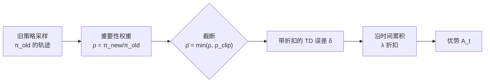

# V-trace 科普：为什么算优势还要"打折"，本仓怎么算的

> 一句话：V-trace 是"用旧策略采的数据，给新策略算优势"时的折扣算法。数据越旧、策略差得越远，
> 折扣越狠；`lambda` 控制"看多远"，`rho`/`c` 控制"敢信多少"。
>
> 本仓实现：`pufferlib/extensions/pufferlib.cpp:28-41`（CPU）与 `pufferlib/extensions/cuda/pufferlib.cu:7-50`（GPU），
> 由 `pufferl.py:646` 的 `_compute_advantages` 调用。

---

## 1. 为什么需要它

PPO 的训练数据是这样来的：

```
 旧策略 π_old  ──跑环境──►  一批轨迹 (s, a, r)  ──►  更新策略变成 π_new
```

更新完之后，这批轨迹已经不是 `π_new` 采的了。算优势（advantage）时如果假装是，就会引入偏差：

- 某个动作在旧策略下概率很低、在新策略下概率很高 → 这条轨迹对 `π_new` 是**稀有样本**，
  它在旧策略下的回报不能代表 `π_new` 会得到什么；
- 反过来，若某动作在新策略下几乎不会做，那它的回报对 `π_new` 毫无意义。

**折扣的做法**：按重要性权重 `π_new(a|s) / π_old(a|s)` 给每条回报加权，并且**截断**权重上限，
防止一两条"运气好"的稀有样本把整批更新带偏。



---

## 2. 三段递推（就是那 14 行 C++）

本仓的实现极其紧凑，去掉校验后只有这么多：

```c
// pufferlib/extensions/pufferlib.cpp:28-41
void puff_advantage_row(float* values, float* rewards, float* dones,
        float* importance, float* advantages, float gamma, float lambda,
        float rho_clip, float c_clip, int horizon) {
    float lastpufferlam = 0;
    for (int t = horizon-2; t >= 0; t--) {
        int t_next = t + 1;
        float nextnonterminal = 1.0 - dones[t_next];
        float rho_t = fminf(importance[t], rho_clip);      // ① 折扣回报的权重
        float c_t   = fminf(importance[t], c_clip);        // ② 折扣"累积"的权重
        float delta = rho_t * (rewards[t_next] + gamma*values[t_next]*nextnonterminal - values[t]);
        lastpufferlam = delta + gamma*lambda*c_t*lastpufferlam*nextnonterminal;  // ③
        advantages[t] = lastpufferlam;
    }
}
```

三件事，逐个说：

| 符号 | 代码 | 含义 |
|---|---|---|
| `δ_t` | `rewards[t_next] + γV(t+1)·mask − V(t)` | **TD 误差**：走一步之后，"实际拿到的 + 后面预估"比"原来预估"好多少 |
| `ρ̄_t` | `min(importance[t], rho_clip)` | 截断后的重要性权重，乘在 TD 误差上 |
| `c̄_t` | `min(importance[t], c_clip)` | 截断后的权重，乘在**累积项**上（控制"多相信过去的推测"） |
| 递推 | `A_t = δ_t + γλ c̄_t A_{t+1}` | 沿时间反向累积，`λ` 越接近 1 看得越远 |

两个容易看错的细节：

1. **倒着算**（`t` 从 `horizon-2` 到 `0`），因为 `A_t` 依赖 `A_{t+1}`；
2. **回报用的是 `t+1` 的索引**：`rewards[t_next]` 与 `dones[t_next]`。第 t 步执行动作后得到
   `r_{t+1}`，"这步的好处在下一步才结算"，终止标志同理。
3. `horizon-1` 那一格的 `advantages` **保持为 0**（循环不写它）。它只是 GAE 的 bootstrap 边界，
   训练时被 `masks` 掩掉（见下文 `masked_fraction`）。

---

## 3. 一个 4 步的手算例子

设 `γ = 0.99`、`λ = 0.95`、全程无终止（`nextnonterminal = 1`）、`values = [1.0, 1.2, 0.9, 1.5]`、
`rewards = [0, 1.0, 0.0, 2.0]`（`rewards[0]` 不使用）。

**第一步：算 TD 误差**（`rho` 全取 1，简化）

| t | `δ_t = r_{t+1} + γV_{t+1} − V_t` |
|---|---|
| 0 | `1.0 + 0.99×1.2 − 1.0 = 1.188` |
| 1 | `0.0 + 0.99×0.9 − 1.2 = −0.309` |
| 2 | `2.0 + 0.99×1.5 − 0.9 = 2.585` |

**第二步：倒着累积**（`A_3 = 0`）

```
A_2 = 2.585
A_1 = −0.309 + 0.99×0.95×2.585 = 2.124
A_0 = 1.188 + 0.99×0.95×2.124 = 3.186
```

注意 `A_1` 是**正的**：单步看是负的（`δ_1 = −0.309`），但它后面紧跟着一个 2.0 的大奖励，
`λ = 0.95` 让它把后面那笔"功劳"借了过来。这就是 `λ` 的作用 —— `λ = 0` 退化成单步 TD，
`λ = 1` 退化成蒙特卡洛回报。

---

## 4. `rho` 和 `c` 不是一个东西

这是 V-trace 最容易搞混的地方：

- **`rho_clip`（ρ̄）** 乘在 **TD 误差**上 —— 决定"这一格的即时优势能信几分"；
- **`c_clip`（c̄）** 乘在 **累积项**上 —— 决定"从下一格往前传的历史优势能信几分"。

为什么分开：重要性权重的方差随累积步数指数增长。如果两处都用 `ρ`，长序列会把方差放大到无法训练；
`c` 的截断相当于给"历史累积"加了个安全阀。实践中通常 `ρ_clip = c_clip`（本仓默认都是 1，
见 `puffer_drive.yaml:357-358`），但算法上它们是两个旋钮。

---

## 5. 本仓的一个关键事实：非 RNN 路径下 V-trace 退化成 GAE

看调用处：

```python
# pufferlib/pufferl.py:646-661  (_compute_advantages)
advantages = compute_puff_advantage(
    self.values,
    self.rewards,
    terminals,
    ratio,                    # ← 传进来的是不是真的 π_new/π_old？
    torch.zeros_like(self.values, device=device),
    config["gamma"],
    config["gae_lambda"],
    rho_clip,
    c_clip,
)
```

再往上追一层：

```python
# pufferl.py:732-739  (_train_ppo_transition，非 RNN 路径)
advantages, returns, masks = self._compute_advantages(
    torch.ones_like(self.values, device=device),   # ratio 全是 1
    1.0,                                           # rho_clip = 1
    1.0,                                           # c_clip   = 1
)
```

`importance ≡ 1` 且两个 clip 都是 1 时，`ρ̄ = c̄ = 1`，递推变成：

```
A_t = δ_t + γλ·A_{t+1}     ← 这就是 GAE(γ, λ)
```

**所以：本仓在 `use_rnn = false`（默认配置 `rnn_name: null`）时跑的是标准 GAE，
V-trace 只是同一份内核的特例。** 真正用上 V-trace 的折扣能力是在 RNN 路径
（`_train_ppo_trajectory`，`pufferl.py:666+`）：它每次更新前用**当前策略**重算
`ratio`，并且按优势大小做优先采样。

这不是 bug，是有意为之的工程选择：

| 路径 | ratio 来源 | 效果 |
|---|---|---|
| 非 RNN（默认） | 恒为 1 | GAE，一次采样一次更新，PPO 的 clip 负责纠正偏差 |
| RNN | 每轮重算 `π_new/π_old` | 真正的 V-trace，多次复用同一批轨迹也安全 |

**看代码时别被名字骗了**：函数叫 `compute_puff_advantage`、内核叫 V-trace，但你要看传进去的
`importance` 才能判断当下跑的是 GAE 还是 V-trace。

---

## 6. 边界与陷阱（踩过的）

| 现象 | 原因 | 处置 |
|---|---|---|
| 优势出现 NaN | 单条 transition 时 `mb_adv.std()` 无定义 | `pufferl.py` 里 `retained_transition_count % minibatch_size == 1` 时最后一条不参与本次更新 |
| 优势无意义 | 长度 1 的序列（`horizon-1 == 0` 时循环不跑） | 用 `bptt_horizon ≥ 2`；本仓默认 128 |
| 终止后仍在累积 | 忘了乘 `nextnonterminal` | 代码里 `dones[t_next]` 已处理；`terminals = (terminals \| ~masks)` 把"被掩掉的行"也当终止 |
| 换成 uint8 的 dones | 内核只接受 `float32` 且要求同 device | `vtrace_check` 会直接 `TORCH_CHECK` 报错（`pufferlib.cpp:43-58`） |

---

## 7. 和相关算法的关系（一张表）

| 算法 | 优势估计 | 能否复用旧数据 | 本仓哪里用 |
|---|---|---|---|
| A2C | `δ_t`（单步 TD） | 勉强 | — |
| GAE(λ) | `δ_t + γλA_{t+1}`，无重要性权重 | 单轮复用 | 非 RNN 路径（默认） |
| **V-trace** | 带 `ρ̄`、`c̄` 的累积 | 多轮复用也安全 | RNN 路径 |
| Retrace(λ) | 类似，但 `c` 取 1 | 多轮 | — |
| VMPO / IMPALA | V-trace + 额外 KL 约束 | 多轮 | — |

---

## 8. 想改它的时候看哪里

| 想做的事 | 改哪 |
|---|---|
| 换 `γ`/`λ` | `puffer_drive.yaml:322-323`（`gamma` / `gae_lambda`） |
| 收紧 V-trace 折扣 | `puffer_drive.yaml:357-358`（`vtrace_rho_clip` / `vtrace_c_clip`），注意只在 RNN 路径生效 |
| 改递推公式 | `pufferlib/extensions/pufferlib.cpp` 与 `pufferlib/extensions/cuda/pufferlib.cu` **两处都要改**（否则 CPU/CUDA 结果不一致），改完必须 `scripts/build_cpu_ext.sh` |
| 改多步验收 | `tests/unit_tests/` 里有 V-trace 对拍用例；改公式后先跑它们 |

> 改完记得重建：`scripts/build_cpu_ext.sh`（默认编 CUDA 版；CUDA 不可用时加 `--cpu-only`）。
